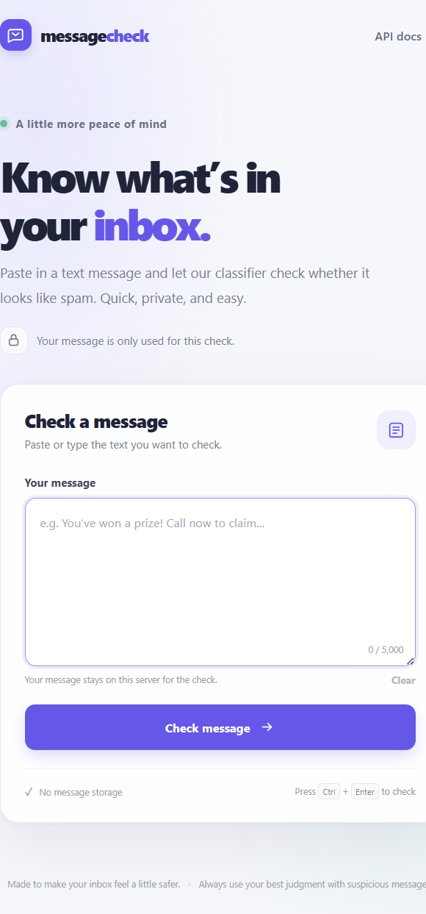
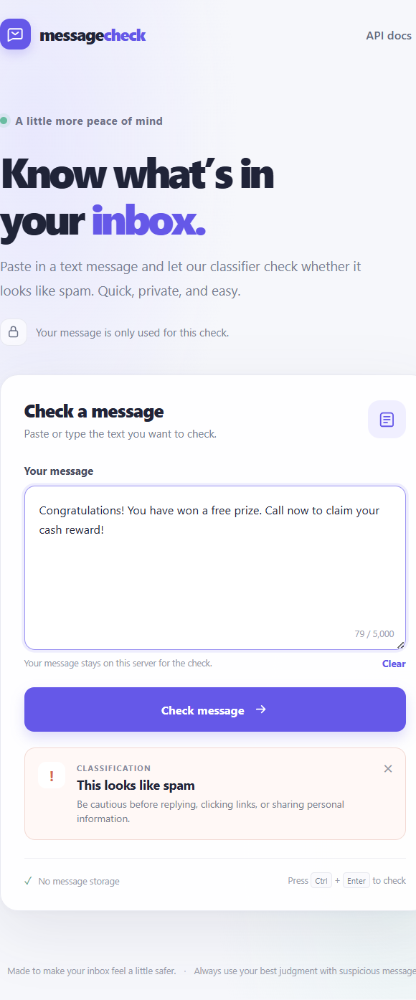

# SMS Spam Classifier

A small web app that classifies an SMS message as spam or not spam. It combines an NLP preprocessing pipeline and a trained scikit-learn model with a FastAPI backend and a responsive HTML, CSS, and JavaScript interface.

## Live demo

- **Web app:** [sms-spam-classifier-fd85.onrender.com](https://sms-spam-classifier-fd85.onrender.com/)
- **Interactive API docs:** [OpenAPI / Swagger UI](https://sms-spam-classifier-fd85.onrender.com/docs)
- **Health check:** [Service status](https://sms-spam-classifier-fd85.onrender.com/health)

> The Render free instance may sleep when inactive. Its first request after a period of inactivity can take around 50 seconds or more.

## Screenshots

| Classifier | Spam prediction |
| --- | --- |
|  |  |

## Features

- Classifies messages as **spam** or **ham** (not spam).
- Responsive interface with character count, clear action, keyboard shortcut, loading feedback, and accessible result messages.
- FastAPI prediction endpoint with input validation and automatically generated API docs.
- Reuses the included model and vectorizer artifacts; no training step is needed for normal use.

## Run locally on Windows

Prerequisites: Python 3.12 and Git.

```powershell
git clone https://github.com/sayan1243/spam-classifier.git
cd spam-classifier
py -3.12 -m venv .venv
.\.venv\Scripts\Activate.ps1
python -m pip install -r requirements.txt
python -m uvicorn app:app --reload
```

Open [http://127.0.0.1:8000](http://127.0.0.1:8000). The interactive API documentation is at [http://127.0.0.1:8000/docs](http://127.0.0.1:8000/docs).

NLTK downloads its tokenizer and stopword resources if they are not already available. To retrain the model artifacts from `spam.csv`, run `python train_model.py` before starting the app.

## Prediction API

Send a JSON request to `POST /api/predict`:

```bash
curl -X POST "https://sms-spam-classifier-fd85.onrender.com/api/predict" \
  -H "Content-Type: application/json" \
  -d "{\"message\":\"Congratulations! You have won a free prize. Call now to claim your cash reward!\"}"
```

Example response:

```json
{
  "prediction": "spam",
  "is_spam": true
}
```

The `message` must contain non-whitespace text and may be up to 5,000 characters. For local testing, replace the demo URL with `http://127.0.0.1:8000`.

## Model and preprocessing

Messages are normalized by tokenizing, lowercasing, removing stopwords and punctuation, and stemming. A TF-IDF vectorizer transforms the processed text for a soft-voting classifier combining an SVM, Multinomial Naive Bayes, and Extra Trees. The serialized `vectorizer.pkl` and `model.pkl` artifacts are loaded on the first prediction and cached for subsequent requests.

## Deploy to Render

The repository includes a `render.yaml` Blueprint that configures a Python web service, installs `requirements.txt`, starts Uvicorn on Render's assigned port, and checks `/health`. To create or update the Render service, connect the GitHub repository and deploy the Blueprint using the `main` branch.
